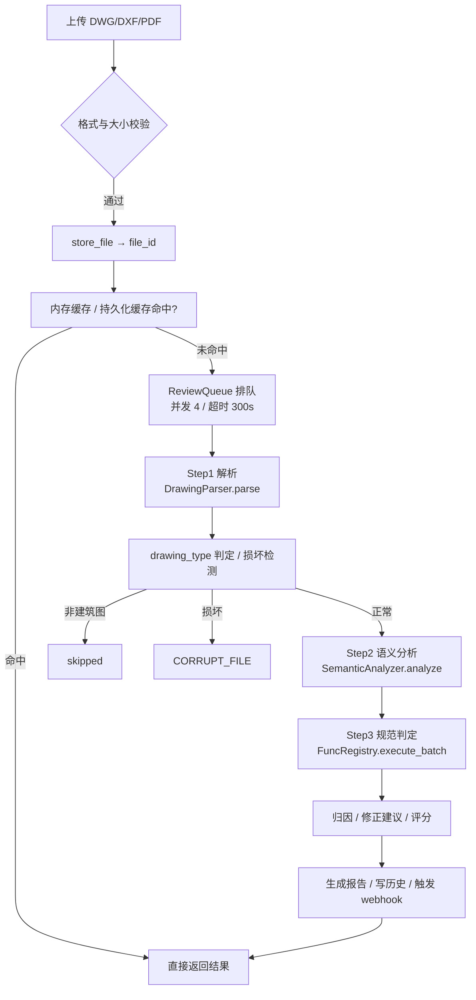

# 01 · 整体架构

## 1. 项目定位

BAA（Blueprint AI Agent）是一个**建筑图纸合规智能体**。它把 CAD 图纸（DWG / DXF）与矢量 PDF 图纸，
自动解析为结构化实体（墙、门、柱、房间、消防设备……），再通过规则化的「原子函数」引擎
逐条比对国家/国际规范（GB50016、GB50974、GB50763、GB50067、NFPA101/5000），
输出带证据链的合规结论与修正建议。

系统的设计原则是**矢量原生**：优先从图纸矢量数据中提取语义，而非依赖渲染成位图后做视觉识别
（YOLO 仅作为消防设备符号的辅助补充手段）。

## 2. 分层架构

```
┌──────────────────────────────────────────────────────────────────┐
│  接入层  REST API (FastAPI) │ Python SDK │ MCP Server │ Skill 包   │
├──────────────────────────────────────────────────────────────────┤
│  前端 SPA   TypeScript + Vite（IIFE bundle，挂载到 index.html）    │
├──────────────────────────────────────────────────────────────────┤
│  服务层   src/api/  —— 路由、鉴权、缓存、任务队列、webhook         │
│           ├─ review/    审查主链路（review / render / compare …）  │
│           ├─ admin_routes、collab_routes、collab/audit_routes      │
│           └─ api_globals —— 全局单例与引擎引用                     │
├──────────────────────────────────────────────────────────────────┤
│  引擎层   src/baa_engine/                                          │
│           ├─ parsers/           图纸解析（DWG 六级兜底 / PDF 矢量） │
│           ├─ semantic_analyzer/ 语义识别（图层规则 / 扫线法 / 疏散）│
│           ├─ atomic_functions.py + atomic/  原子函数体系（431 条）  │
│           ├─ spec_data/         规范知识库（199 条 Clause）         │
│           ├─ report_generator/  PDF 审查报告                        │
│           ├─ correction_engine / llm_correction  修正建议           │
│           ├─ reverse_engine     反向重构（结构化 → DXF/DWG）        │
│           └─ task_queue / cache / api_key_manager / team_collab …   │
├──────────────────────────────────────────────────────────────────┤
│  基础设施  SQLite(缓存/协作) │ webhook │ i18n │ Docker/K8s/CI       │
└──────────────────────────────────────────────────────────────────┘
```

## 3. 端到端数据流（核心审查链路）



### 关键阶段说明

| 阶段 | 组件 | 产出 |
| --- | --- | --- |
| 解析 | `DrawingParser` + `parsers/*` | `DrawingResult`（primitives / dimensions / sheets / block_refs / drawing_type / corrupt） |
| 语义 | `SemanticAnalyzer` | `SemanticEntity` 列表 + `SpatialRelation` 关系 + 属性 + 疏散拓扑 |
| 判定 | `FuncRegistry` + `SpecRepository` | `FuncResult` 列表（PASS / FAIL / 降级） |
| 归因 | `AttributionAnalyzer` | `Finding`（违规 + 证据 + 条款引用） |
| 修正 | `CorrectionEngine` / `LLMCorrectionEngine` | `CorrectionSuggestion` |
| 报告 | `ReviewReport` | PDF（封面 / 评分 / 摘要 / 违规明细 / 修正页） |

## 4. 请求承载与并发模型

- **FastAPI lifespan**：进程启动时由 `_engine_thread` 预热全部引擎单例
  （`DrawingParser`、`SemanticAnalyzer`、`FuncRegistry`、`AttributionAnalyzer`、
  `SpecRepository`、`FeedbackManager`、`LearningEngine`），并启动 `_periodic_gc`（每 300s）。
- **引擎引用注入**：`_load_engine_sync` 通过 `sys.modules[__name__]` 将引擎实例写回模块全局，
  `api_globals` 中的惰性 getter 再对外暴露，避免循环导入。
- **线程池**：`ENGINE_THREAD_POOL = ThreadPoolExecutor(max_workers=min(8, cpu*2))`，
  解析与判定等 CPU 密集任务在其中运行，不阻塞事件循环。
- **审查队列**：`ReviewQueue(max_concurrent=4, queue_timeout=300.0)`，
  超时任务返回 partial 结果。
- **缓存**：内存缓存 `_review_cache`（上限 100）+ SQLite 持久化缓存 `PersistentCache`
  （WAL、TTL/LRU），cache_key = `make_cache_key(file_hash, standard, building_type)`。

## 5. 鉴权模型

- **API Key**：`ApiKeyManager` 生成 `baa_` 前缀原始密钥，服务端仅存 SHA-256 哈希；
  密钥元数据用 AES-GCM 加密落库；支持过期、权限（`ApiKeyPermission`）、用量统计与轮换。
  `verify_api_key` 在 `API_KEYS` 为空时允许匿名访问（便于开发）。
- **JWT（auth_token）**：`generate_auth_token` / `verify_auth_token` 基于 HMAC-SHA256，
  支持 `AUTH_SECRETS` 多密钥宽限期，用于付费/受保护接口。
- **管理接口**：`require_admin` 校验管理员身份。

## 6. 关键设计决策

1. **矢量原生优先**：避免光栅化后做视觉识别；YOLO 仅用于设备符号补充，不进入主干判定。
2. **规范知识库与判定逻辑解耦**：`Clause`（条款）与 `AtomicFunction`（判定函数）分离，
   条款阈值可通过反馈闭环动态调整并写入 spec repo。
3. **原子函数可组合**：`depends_on` 声明前置依赖，`FuncRegistry.resolve_dependencies` 拓扑排序，
   `requires_global_context` 标记不参与逐实体循环的全局判定函数。
4. **六级 DWG 兜底**：`_try_same_dir_dxf → _try_librecad_convert → _try_aspose_cad_convert →
   _try_ezdwg_export_dxf → _try_manual_convert → _try_raw_decode`，
   并对天正 T3 加密对象做专门降级处理。
5. **可观测与回归**：`/health` 汇报子系统状态；真实图纸人工标注基线 + CI 阶段化回归保证不漂移。

## 7. 相关既有文档

仓库中另有设计与运行文档可配合阅读：

- [API.md](../API.md)、[USER_GUIDE.md](../USER_GUIDE.md)、[DEPLOY.md](../DEPLOY.md)
- [ci-cd-guide.md](../ci-cd-guide.md)、[cross-platform-checklist-20261015.md](../cross-platform-checklist-20261015.md)
- `docs/07-重大变更/` 下的详细设计（DD-1 原子函数库 / DD-4 解析管线 / DD-8 API 服务层 等）
